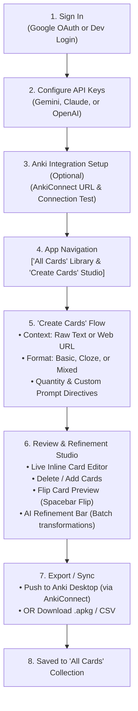

# Anki Maker: Architecture & Implementation Plan

A clean, minimal, production-grade flashcard generation and management tool built with **FastAPI** (Python) and **React** (TypeScript + Tailwind CSS), containerized with **Docker** for cloud deployment.

---

## 1. Project Vision & Philosophy

- **Effortless Context-to-Cards**: Ingest raw text or web URLs, strip noise, and use modern LLMs (Gemini, Claude, GPT) to generate high-quality flashcards.
- **Human-in-the-Loop Refinement**: Flashcard quality depends on review. Users can inline-edit, delete, test cards in flip mode, or instruct the LLM to make batch modifications ("make answers more concise", "convert cards 2-5 to cloze").
- **Zero Friction Sync**: Direct 1-click sync to desktop Anki via AnkiConnect or standalone `.apkg` / CSV file download (no desktop app required).
- **Clean & Minimal Aesthetic**: High-signal typography, generous whitespace, crisp borders, and subtle animations. No unnecessary clutter or AI buzzword styling.
- **BYOK (Bring Your Own Key)**: Users configure their own API keys for Gemini, Claude, or OpenAI, stored securely per account.

---

## 2. End-to-End User Journey



---

## 3. Tech Stack

| Layer | Technologies | Rationale |
|---|---|---|
| **Backend** | Python 3.11+, FastAPI, Uvicorn | Asynchronous, fast performance, native Pydantic v2 validation. |
| **Database** | SQLite (dev) / PostgreSQL (prod), SQLAlchemy 2.0 | Lightweight local storage with seamless production database swap. |
| **Authentication** | Google OAuth (`google-auth`) + Stateless JWT | Secure single sign-on with development bypass for local workflows. |
| **Key Security** | Cryptography (`Fernet` symmetric encryption) | Per-user LLM API keys encrypted at rest in the database. |
| **URL Scraper** | `trafilatura`, `httpx`, `beautifulsoup4` | Extracts clean article body text while stripping ads, navigation, and boilerplate. |
| **Anki Packaging** | `genanki` | Generates valid `.apkg` files with Basic and Cloze note models. |
| **Anki Desktop Sync**| AnkiConnect HTTP Client (`localhost:8765`) | Direct JSON-RPC communication with local Anki desktop instance. |
| **LLM Providers** | Google Gemini (`google-genai`), OpenAI (`openai`), Anthropic (`anthropic`) | Multi-provider structured output with Pydantic schema enforcement. |
| **Deployment** | Docker, Docker Compose | Containerized backend ready for any cloud provider (Render, Railway, Fly.io, GCP). |
| **Frontend** | React 18, Vite, TypeScript, Tailwind CSS, Lucide Icons | Fast HMR, clean minimal UI, accessible keyboard interactions. |

---

## 4. System Architecture

```
anki-maker/
├── backend/
│   ├── app/
│   │   ├── __init__.py
│   │   ├── main.py                 # FastAPI application, CORS & route mounting
│   │   ├── config.py               # App settings & environment variables
│   │   ├── database.py             # SQLAlchemy session & engine setup
│   │   ├── models/                 # Database models
│   │   │   ├── user.py             # User & UserSettings (encrypted keys)
│   │   │   ├── deck.py             # Flashcard decks & metadata
│   │   │   └── card.py             # Individual flashcards (front, back, cloze, tags)
│   │   ├── schemas/                # Pydantic request & response schemas
│   │   │   ├── auth.py             # Login & token schemas
│   │   │   ├── user.py             # Profile & API key management schemas
│   │   │   ├── card.py             # Card generation & refinement schemas
│   │   │   └── anki.py             # AnkiConnect sync schemas
│   │   ├── services/
│   │   │   ├── crypto.py           # Encryption/decryption for API keys
│   │   │   ├── auth.py             # Google ID token verification & JWT creation
│   │   │   ├── extractor.py        # Web URL & text content cleaner
│   │   │   ├── anki_connect.py     # AnkiConnect desktop gateway
│   │   │   ├── exporter.py         # genanki .apkg & CSV file generator
│   │   │   └── llm/                # Multi-provider LLM engine
│   │   │       ├── base.py         # Abstract LLM base provider
│   │   │       ├── gemini.py       # Google Gemini provider
│   │   │       ├── openai_p.py     # OpenAI GPT provider
│   │   │       ├── anthropic_p.py  # Anthropic Claude provider
│   │   │       └── factory.py      # Provider resolver using decrypted user keys
│   │   └── routers/
│   │       ├── auth.py             # /api/auth (Google OAuth, Me, Dev-login)
│   │       ├── settings.py         # /api/settings (API Keys & Anki configuration)
│   │       ├── extract.py          # /api/extract (URL text extraction)
│   │       ├── cards.py            # /api/cards (Generate, Refine, Edit, Delete)
│   │       ├── decks.py            # /api/decks (All Cards list & management)
│   │       ├── anki.py             # /api/anki (Test connection, list decks, sync)
│   │       └── export.py           # /api/export (.apkg & .csv downloads)
│   ├── tests/                      # Automated test suite
│   ├── Dockerfile                  # Container definition for online deployment
│   ├── .dockerignore
│   ├── requirements.txt
│   └── .env.example
├── frontend/                       # React + TypeScript frontend
│   ├── src/
│   │   ├── components/             # Minimal UI components (CardList, Editor, SyncModal)
│   │   ├── pages/                  # AllCardsPage, CreateCardsPage, SettingsPage, LoginPage
│   │   ├── services/               # API clients
│   │   └── types/                  # Shared TypeScript types
│   ├── package.json
│   └── vite.config.ts
├── docker-compose.yml              # Local orchestration
└── PLAN.md                         # This file
```

---

## 5. Database Schema

### `users`
- `id` (String / UUID, Primary Key)
- `email` (String, Unique, Indexed)
- `name` (String)
- `picture` (String, Optional)
- `created_at` (DateTime)

### `user_settings`
- `id` (Integer, Primary Key)
- `user_id` (String, Foreign Key -> `users.id`, Unique)
- `gemini_api_key_enc` (String, Encrypted)
- `anthropic_api_key_enc` (String, Encrypted)
- `openai_api_key_enc` (String, Encrypted)
- `preferred_provider` (String: `gemini` | `anthropic` | `openai`, Default: `gemini`)
- `preferred_model` (String, Optional)
- `anki_url` (String, Default: `http://localhost:8765`)

### `decks`
- `id` (String / UUID, Primary Key)
- `user_id` (String, Foreign Key -> `users.id`)
- `title` (String)
- `source_type` (String: `text` | `url`)
- `source_content` (Text, Excerpt/URL)
- `created_at` (DateTime)
- `updated_at` (DateTime)

### `cards`
- `id` (String / UUID, Primary Key)
- `deck_id` (String, Foreign Key -> `decks.id`, Cascade Delete)
- `card_type` (String: `basic` | `cloze`)
- `front` (Text)
- `back` (Text)
- `tags` (JSON / List of strings)
- `source_context` (Text, Optional snippet)
- `order_index` (Integer)

---

## 6. Key API Endpoints

### Authentication & Settings
- `POST /api/auth/google` – Sign in/up with Google ID token, returns JWT bearer token.
- `POST /api/auth/dev-login` – Development login for testing without Google credentials.
- `GET /api/auth/me` – Retrieve current user profile.
- `GET /api/settings` – Retrieve masked API keys and preferences.
- `PUT /api/settings` – Update API keys (Gemini, Claude, OpenAI) and AnkiConnect URL.

### Context & Card Generation
- `POST /api/extract` – Ingests a web URL, returns title and clean article body.
- `POST /api/cards/generate` – Generates structured cards from text/URL using the user's selected LLM provider.
- `POST /api/cards/refine` – Takes existing cards + instructions ("shorter answers", "change to cloze") and returns updated deck.

### Deck & Card Library ("All Cards")
- `GET /api/decks` – Lists all user's saved decks with card counts.
- `GET /api/decks/{id}` – Gets deck with all cards.
- `PUT /api/decks/{id}` – Renames or updates deck metadata.
- `DELETE /api/decks/{id}` – Deletes deck and cards.
- `POST /api/decks/{id}/cards` – Adds a manual card.
- `PUT /api/cards/{id}` – Edits card front, back, type, or tags.
- `DELETE /api/cards/{id}` – Deletes single card.

### Anki Integration & Export
- `POST /api/anki/test` – Tests connectivity to user's AnkiConnect instance.
- `GET /api/anki/decks` – Lists available decks in user's desktop Anki.
- `POST /api/anki/sync` – Pushes deck cards directly into desktop Anki.
- `GET /api/export/deck/{id}/apkg` – Direct download of `.apkg` file.
- `GET /api/export/deck/{id}/csv` – Direct download of Anki-compatible CSV.

---

## 7. Cloud Deployment & Docker Strategy

### `backend/Dockerfile`
- Base image: `python:3.11-slim`
- Installs necessary build dependencies and `curl` for container health checks.
- Sets non-root user `appuser` for security.
- Healthcheck endpoint: `curl -f http://localhost:8000/api/health || exit 1`
- Exposes port `8000`.
- Starts `uvicorn app.main:app --host 0.0.0.0 --port 8000`.

### Environment Variables
- `DATABASE_URL`: `sqlite:///./anki_maker.db` (or `postgresql://...` for production)
- `SECRET_KEY`: Used for JWT signing and symmetric key encryption
- `GOOGLE_CLIENT_ID`: Optional in dev, required in production for Google OAuth verification
- `CORS_ORIGINS`: Comma-separated allowed frontend domains (e.g. `http://localhost:5173,https://your-frontend.com`)

---

## 8. Implementation Roadmap

1. **Step 1: Backend Setup & Docker Container**
   - Setup project structure, `requirements.txt`, `config.py`, database models, and `Dockerfile`.
2. **Step 2: Authentication & API Key Vault**
   - Implement Google OAuth verification, dev-login bypass, JWT tokens, and encrypted user settings.
3. **Step 3: Extraction & Multi-Provider LLM Engine**
   - Implement URL extraction (`trafilatura`), structured flashcard generation, and iterative refinement across Gemini, Claude, and OpenAI.
4. **Step 4: AnkiConnect Sync & APKG Exporter**
   - Implement AnkiConnect HTTP client and `genanki` `.apkg` / CSV builders.
5. **Step 5: Deck & Card Management Endpoints**
   - CRUD operations for All Cards section, manual additions, and inline edits.
6. **Step 6: React Frontend (Clean Minimal UI)**
   - Auth flow, Settings page (API keys), Create Cards studio, Review & Refinement bar, All Cards library, and 1-click sync/export modal.
